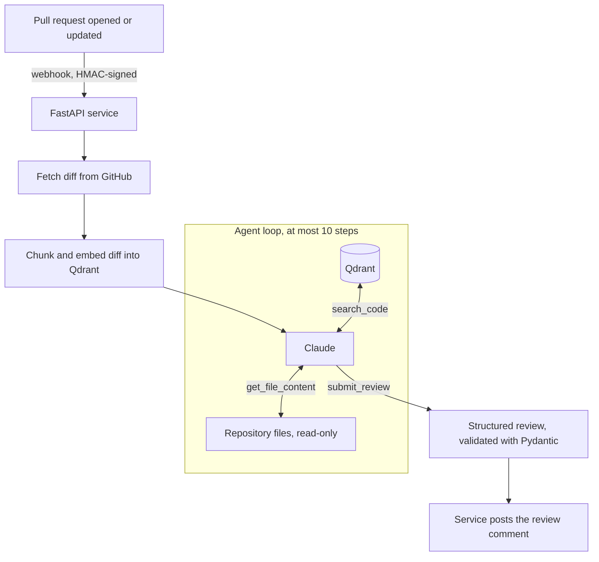

# PR Review Assistant

An LLM agent that reviews GitHub pull requests. When a pull request is opened or updated, the service fetches the diff, lets the agent explore the repository with read-only tools, and posts a structured review back to the pull request.

The repository also contains a [controlled experiment](experiments/context_ablation/) that tests whether giving the agent more context actually helps.

## How it works



1. **Webhook.** GitHub sends a `pull_request` event. The service checks the HMAC-SHA256 signature and ignores unsigned or unrelated events.
2. **Indexing.** The diff is split into chunks, embedded with OpenAI embeddings and stored in Qdrant.
3. **Agent loop.** Claude gets the diff and three tools:
   - `search_code`: semantic search over the changed code
   - `get_file_content`: read a full file from the repository at the PR's head commit
   - `submit_review`: return the final review, which must match a Pydantic schema

   The agent decides when it needs more context. The loop stops when it submits a review or after 10 steps.
4. **Posting.** The service, not the agent, posts the review as a PR comment. The review covers logic, security, code quality, performance and test coverage.

## Design choices

- **Read-only tools.** The agent can only read. Posting the comment happens outside the agent loop, so a misled agent cannot change the repository.
- **Step limit and truncation.** At most 10 steps, and file contents are truncated, so one review cannot run away in cost or context size.
- **Structured output.** Reviews are validated against a Pydantic schema before they are posted.
- **Keyless deployment.** GitHub Actions deploys to Cloud Run with Workload Identity Federation, so no long-lived cloud keys are stored.

## Evaluation

[`experiments/context_ablation`](experiments/context_ablation/) compares three agent setups on 27 real pull requests from fastapi, requests and httpx, using issues raised by human reviewers as reference answers:

| Setup | Tools |
|---|---|
| C0 | diff only |
| C1 | diff + `search_code` (more steps, no new information) |
| C2 | diff + `search_code` + `get_file_content` (real repository context) |

Main results (see [`summary.md`](experiments/context_ablation/data/summary.md)):

- More context did not find more of the human-reported issues. The recall differences were within run-to-run noise.
- C1 cost about 60% more than C0 per review (paired permutation test, p = 0.006), because every extra step resends the whole conversation.
- Two LLM judges disagreed on many issue matches, so disagreements were checked by hand.

## Known limitations

- The GitHub token used for fetching and posting has broader permissions than the service needs. A GitHub App with read access to code and write access to PR comments only would be safer.
- The in-memory vector store is shared, so two reviews running at the same time could mix chunks. Each review should use its own collection.
- Error messages are posted to the PR as they are, which can expose internal details.

## Project structure

```
app/
  webhook/router.py    webhook endpoint, signature check, posting the review
  agent/reviewer.py    agent loop and tools
  rag/                 chunking, embedding, Qdrant storage and search
  github/client.py     GitHub API calls
  schemas/review.py    review schema
tests/                 unit tests, run in CI on every pull request
experiments/           context ablation experiment
```

## Running locally

```bash
pip install -r requirements.txt
cp .env.example .env   # add your Anthropic, OpenAI and GitHub keys and a webhook secret
uvicorn app.main:app --reload --port 8080
pytest tests/
```

Then point a GitHub webhook (content type `application/json`, event `pull_request`) at `/webhook/github` with the same secret.

## Stack

Python, FastAPI, Anthropic Claude API, OpenAI Embeddings, Qdrant, PyGithub, Pydantic, Docker, GitHub Actions, Google Cloud Run
